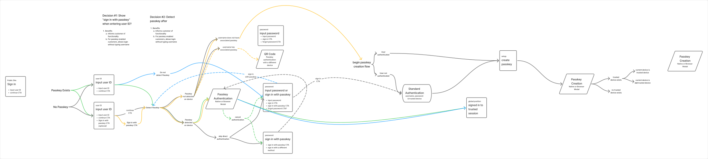
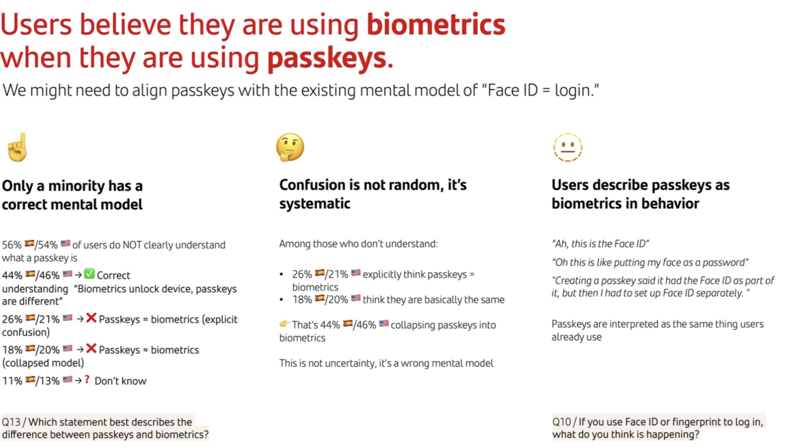
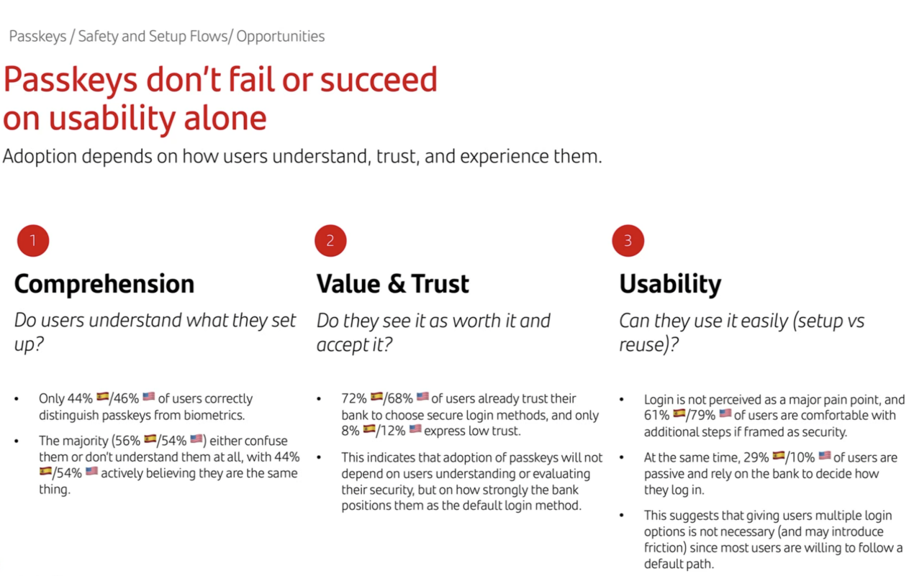
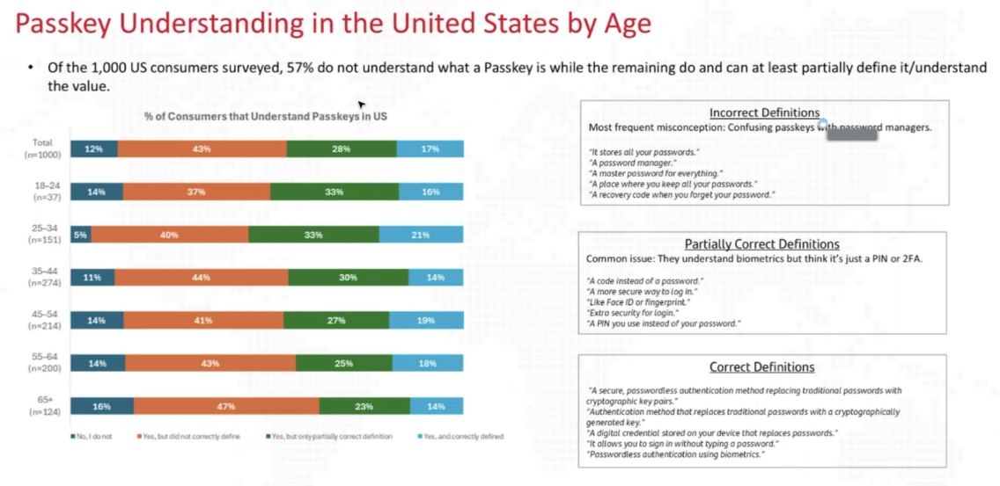

## Surfacing technical capability for user benefit: Passkey Autodetect

When I got involved, product and engineering had already begun diagramming business processes and user flows.

After reviewing industry documentation[^1] at the FIDO Alliance ([PDF](https://fidoalliance.org/wp-content/uploads/2023/05/FIDO-Alliance-UX-Guidelines-for-Passkey-Creation-and-Sign-ins.pdf)), I added value by reworking those same flows from a user-centered lens.

## Influencing Global Research

### A Potential Gap in Customer Mental Models

As the global design and research team partnered with us to validate concepts in the US, **I noticed a potential gap in nomenclature**:

Adding passkeys as a new feature meant that in security settings,  '*passkeys*' would sit below, '*biometrics*'.  

***Passkeys* and *biometrics* are not apples-to-apples**: Passkeys are accessed via biometric authentication, but so are password managers and signing in with Face ID.

- *Biometric authentication* detects or scans one or a more physical traits to form a unique 'fingerprint' of a person that authenticates or 'unlocks' access.  [Facial images, fingerprints, and iris scan samples are all examples of biometrics.](https://csrc.nist.gov/glossary/term/biometrics)
- *Biometrics* is also the label commonly used in Android devices to label this technology
- *Face ID* and *Touch ID* are how Apple devices label this technology.
- On Apple devices, you can [sign in with Face ID](https://support.apple.com/en-us/108411)

Would the different options cause any confusion?

### Feedback for the Global Research Team

More importantly, **would we be creating mental models that customers would understand**, especially given how new of a technology passkeys is and how our customer base at Santander in the US often tilts towards a more mature demographic?

I was grateful for how receptive the Spain-based research team was:

> The goal would be to understand users' mental models before they go through the flows, so we can later correlate adoption or resistance with their level of understanding.[^1]

### Surveying Customer Understanding of Passkeys in the United States

A survey of 1,000 customers found that "57% do not understand what a passkey is..."[^2]

### Shaping the Problem

With guidance from my US UX research colleague, the global research team validated that this *was* a potential gap with customers.

Again, this research was not my own:

## Outcome and Next Steps

### Questions Shaped

The findings above were positioned within a larger picture of designing for adoption by aligning with user's mental modals across countries.

I won't include those details here.

However, it was a privilege to be able to shape the questions the design organization is asking for a feature rollout across a global footprint of ~189 million customers.[^3]

### Product Backlog <- Best Practices

The user flow work I discused earlier helped shape the US product backlog.  I similarly won't discuss that future-oriented work in detail here.

---

[^1]: See FIDO Alliance's [Design User Journeys](https://www.passkeycentral.org/design-user-journeys/#design-patterns) page and [FIDO Alliance UX Guidelines for Passkey Creation and Sign-ins]

[^1]: Passkeys Testing Plan Outline:

[^2]: Passkey Understanding in the United States by Age. *I **didn't** perform this research*:

Research by Kerry W.

[^3]: https://www.santander.com/en/about-us/key-facts-and-figures