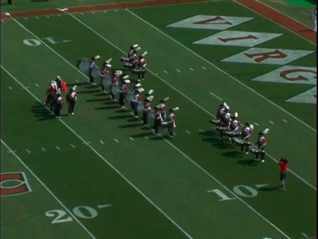

# About

## What kind of designer am I?

### The Tree-Shaped Designer: Measuring AI Maturity

[The Tree-Shaped Designer](https://aiskillsmap.noahratzan.com/)
Thanks John Meada

## Legacy

- UVa Slave Memorial
- Eunoia (Christian arts community, open to all) (include picture) (Instagram)
- 3SoftUSA Computer Teaching Classes
- EE Reed Potomac Science Center
- Sketch & Fajitas newspaper article #community 
- Safrapay Chatbot
- Openbank Launch
- UXPA Boston YouTube
- First Responsible AI Conference
- Marriage, Family, Friends, & Church & Youth

### Drumline & Percussion

#### UVa Cavalier Marching Band

## Writing

- primogeniture essay (history capstone)
- English as global language
- MBA final paper
- Arts and culture of the slave South

### Questions 

- design as repair & Maintenance
- The shipping container
- ‘Technique’
- 'A timeless way of building'

## Community

### Reimagining AI

### Visit to Openbank Spain

### Friends of Figma: Big Medium

### UXPA Boston & SDN Portugal

### Sketch & Fajitas

[Jason teaching symbols in Sketch](https://www.instagram.com/p/B7Hvw_EjoPn/?utm_source=ig_web_button_share_sheet&stkn=MzRlODBiNWFlZA==)

### Eunoia
